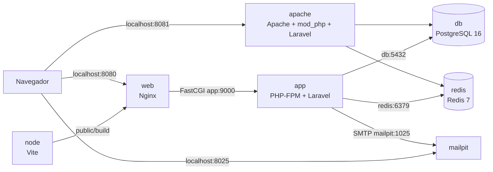
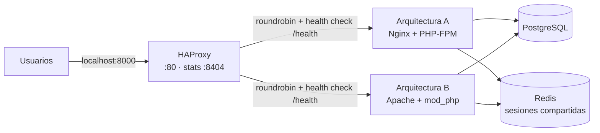
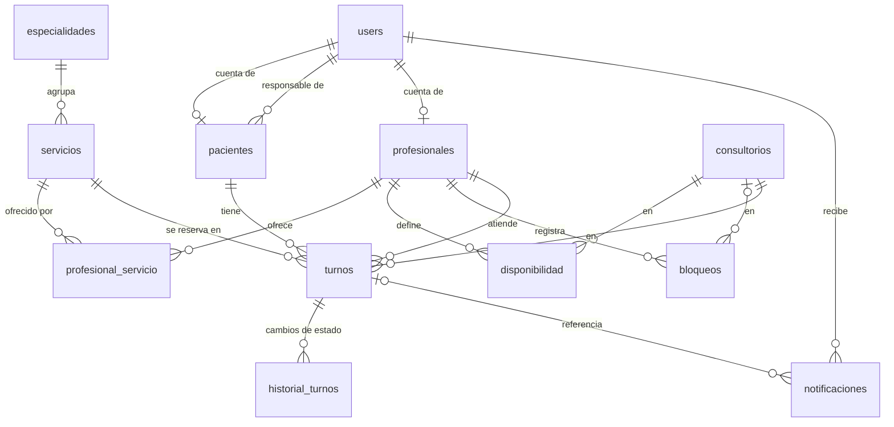
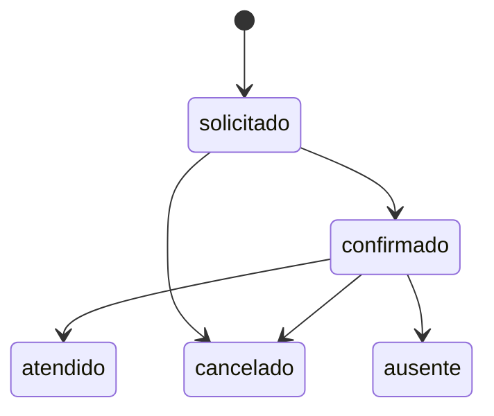

# AgendTurnos — Documento general del proyecto

Sistema web de agendamiento de turnos odontológicos para **Glow Dental Protect**, Asunción, Paraguay.

> Documento vivo: se actualiza a medida que avanza el desarrollo. Cada sección indica su estado: ✅ hecho · 🚧 en curso · ⏳ pendiente.
> Última actualización: 2026-10-22.
> Diseño de interfaz (colores, layouts y componentes): [`docs/diseno-ui.md`](diseno-ui.md).

---

## 1. Contexto y problema

Glow Dental Protect es una clínica odontológica unipersonal. Ofrece consultas, limpiezas, empastes, extracciones y tratamientos de conducto, además de ortodoncia, blanqueamiento, prótesis e implantes.

**Situación actual.** Los turnos se piden por teléfono, WhatsApp, Instagram y Facebook, y se anotan a mano en planillas de Excel. La propia profesional hace este trabajo, porque no hay personal de recepción. Esto le quita tiempo de atención, provoca errores de agenda y genera demoras para los pacientes.

**Solución.** Una plataforma web donde:
- el paciente consulta los servicios, ve los horarios libres, pide un turno y sigue su estado;
- la profesional administra su agenda y su disponibilidad, y confirma o modifica turnos;
- el sistema envía confirmaciones y recordatorios por correo.

## 2. Alcance

### Incluido
- Portal web con información de la clínica y catálogo de servicios.
- Registro e inicio de sesión, con roles **paciente**, **profesional** y **funcionario** (recepción/administración).
- Administración de especialidades, servicios y qué servicios ofrece cada profesional.
- Consulta de disponibilidad y solicitud de turnos.
- Agenda de la profesional: ver, confirmar, reprogramar y cancelar turnos; administrar el horario semanal y los bloqueos.
- Seguimiento del estado del turno por parte del paciente.
- Notificaciones (confirmación, cancelación, reprogramación) y recordatorios automáticos.

### Fuera de alcance (versión inicial)
Historia clínica, facturación y contabilidad, inventario, gestión de varias sucursales (el modelo de datos queda preparado), app móvil nativa, integración directa con redes sociales, pagos en línea, telemedicina, IA y marketing.

## 3. Stack tecnológico

| Capa | Tecnología | Estado |
|---|---|---|
| Framework | Laravel 13 (PHP 8.4) | ✅ |
| Base de datos | PostgreSQL 16 | ✅ |
| Sesiones, caché y colas | Redis 7 (`phpredis`) | ✅ |
| Vistas | Blade + Blade Components | ✅ |
| Estilos | Tailwind CSS 4 (compilado con Vite) | ✅ |
| Interactividad | Alpine.js | ✅ |
| Servidor web, arquitectura A | Nginx + PHP-FPM | ✅ |
| Servidor web, arquitectura B | Apache + mod_php | ✅ |
| Balanceador | HAProxy (stats en puerto 8404) | ✅ |
| Correo en desarrollo | Mailpit | ✅ |
| Contenedores | Docker / Docker Compose | ✅ |
| Orquestación y despliegue | Portainer (Stack) | ⏳ |
| Gestión del proyecto | Scrum en Jira | ✅ |

## 4. Arquitectura

**Estilo de software: monolito MVC en capas (N-Tier).** Una sola aplicación Laravel, organizada en capas horizontales:

| Capa | Componentes | Responsabilidad |
|---|---|---|
| Presentación | Rutas, controladores, FormRequests, vistas Blade y Blade Components | Recibir la petición, validar la entrada y devolver la vista |
| Negocio | Servicios en `app/Services` (ej. `AgendaService`, `DisponibilidadService`) | Reglas del dominio: horarios libres, solicitud y cambios de estado de turnos |
| Datos | Modelos Eloquent (relaciones, scopes, casts) y PostgreSQL | Persistencia e integridad |

Flujo de una petición: ruta → FormRequest → Controller → Service → Model → PostgreSQL → vista Blade. Los controladores se mantienen delgados; no se usa una capa de repositorios porque Eloquent ya cumple ese rol.

### 4.1 Entorno de desarrollo actual ✅

Ocho contenedores en la red interna `agendturnos_default`. Entre ellos se comunican por el nombre del servicio.



| Servicio | Imagen | Puerto interno | Puerto en el host | Función |
|---|---|---|---|---|
| `web` | `nginx:alpine` | 80 | **8080** | Sirve los estáticos y pasa los `.php` a `app` |
| `app` | `php:8.4-fpm-alpine` | 9000 | — | Ejecuta Laravel |
| `queue` | `php:8.4-fpm-alpine` | — | — | Worker de colas (`php artisan queue:work --tries=3`) |
| `scheduler` | `php:8.4-fpm-alpine` | — | — | Ejecución periódica de tareas (`php artisan schedule:work`) |
| `haproxy` | `haproxy:3.0-alpine` | 80 / 8404 | **8000** (`HAPROXY_PORT_FORWARD`) / **8404** | Balancea entre `web` (A) y `apache` (B); Stats en el 8404 (ver 4.2) |
| `apache` | `php:8.4-apache` | 80 | **8081** | Arquitectura B: Apache + mod_php con el mismo código, la misma base y el mismo Redis que A |
| `db` | `postgres:16-alpine` | 5432 | **5436** | Base `agendturnos` |
| `redis` | `redis:7-alpine` | 6379 | **6379** | Sesiones, caché y colas |
| `mailpit` | `axllent/mailpit` | 1025 / 8025 | **8025** | Atrapa los correos de desarrollo |
| `node` | `node:24-alpine` | — | — | Compila Tailwind y Alpine.js con Vite (`npm run build -- --watch`) hacia `public/build` |

**Recorrido de una petición:** el navegador llama a `web:80`. Nginx sirve el archivo si existe en `public/`; si no, deriva a `index.php`, que va a `app:9000` por FastCGI. Laravel consulta `db` y lee o escribe la sesión en `redis`.

**Detalles:**
- El código se monta con `.:/var/www/html:z`; el sufijo `:z` es para SELinux. En `web` el montaje es de solo lectura.
- Los datos persisten en los volúmenes `pgdata` y `redisdata`.
- El usuario `www-data` del contenedor usa el UID 1000, igual que el del host.
- `app` espera a que `db` y `redis` pasen sus healthchecks antes de arrancar.

### 4.2 Balanceo con HAProxy ✅



### 4.3 Benchmark de rendimiento (SCRUM-33 / SCRUM-35) ✅

Se realizó una comparativa de rendimiento entre la **Arquitectura A** (Nginx + PHP-FPM), la **Arquitectura B** (Apache + mod_php) y el balanceador **HAProxy** bajo diferentes niveles de concurrencia (10, 50 y 100 conexiones).

Los resultados empíricos, metodología, análisis de paridad e interpretación técnica se encuentran documentados en [`docs/benchmark.md`](benchmark.md). Para reproducir las mediciones: `make bench`.

- Las dos arquitecturas corren el mismo código y comparten la base de datos y Redis.
- Como la sesión vive en Redis, el usuario no pierde la sesión cuando HAProxy lo cambia de nodo.
- **Entrada:** http://localhost:8000 (HAProxy). Las arquitecturas siguen accesibles directo en 8080 (A) y 8081 (B) para compararlas. Stats en http://localhost:8404. La cabecera `X-Servidor` de cada respuesta dice qué nodo la atendió (`a_nginx` o `b_apache`).
- **Algoritmo `roundrobin`:** las peticiones son cortas y parecidas y la sesión vive en Redis, así que no hace falta fijar al usuario a un nodo. `leastconn` conviene con conexiones largas (websockets, descargas), que esta app no tiene.
- **Health check:** `GET /health` cada 3 s. `/health` responde 200 solo si el nodo llega a PostgreSQL y a Redis. 3 fallos seguidos → DOWN (~10 s con el nodo detenido); 2 aciertos → UP. `timeout check 10s` porque un nodo recién arrancado compila en frío y, con el código montado desde Windows, tarda hasta ~5 s; un nodo detenido falla antes, por `timeout connect 1s`.
- **OPcache:** `opcache.revalidate_freq = 2` (antes 0). Con 0, PHP revisaba la fecha de cada archivo en cada petición, lo que sobre el montaje de Windows llevaba `/health` a ~1,8 s; con 2 baja a ~0,2 s. En desarrollo, un cambio en el código se ve a los 2 s como máximo.
- **Failover:** si un nodo deja de responder, HAProxy lo marca DOWN y manda todo el tráfico al otro. Cuando el nodo vuelve, pasa a UP solo. Mientras detecta la caída, `option redispatch` reintenta en el otro nodo las conexiones fallidas, así que el usuario no ve errores. HAProxy re-resuelve los nombres con el DNS de Docker: si el contenedor vuelve con otra IP, la toma. Guion de la demo: [`docs/demo-failover.md`](demo-failover.md).
- **Benchmarking:** se mide RPS y latencia (p50, p95 y p99) de A, de B y del conjunto balanceado.

## 5. Modelo de datos ✅

Migraciones, seeders y tests de integridad (SCRUM-25); modelos Eloquent con relaciones, Enums (`RolUsuario`, `EstadoTurno`, `EstadoNotificacion`) y factories (SCRUM-40). Diagrama completo, diccionario de datos, restricciones, índices y justificación de la 3FN en [`diccionario-datos.md`](diccionario-datos.md).



| Tabla | Contenido | Restricciones |
|---|---|---|
| `users` | Login: `email`, `password`, `rol` (`paciente`, `profesional`, `funcionario`) | `email` único; `CHECK` de rol |
| `pacientes` | `nombre`, `apellido`, `tipo_documento`, `documento`, `telefono`, `fecha_nacimiento`, `user_id` (nullable), `responsable_id` (nullable) | Único `(tipo_documento, documento)`; `user_id` único |
| `profesionales` | `nombre`, `apellido`, `matricula`, `user_id`, `orden` (smallint, default 100) | `user_id` único |
| `especialidades` | `nombre`, `activa` | `nombre` único |
| `servicios` | `nombre`, `descripcion`, `duracion_min`, `precio` (entero, guaraníes), `activo`, `especialidad_id` | `duracion_min > 0`; `precio >= 0` |
| `profesional_servicio` | Qué servicios ofrece cada profesional | Clave compuesta `(profesional_id, servicio_id)` |
| `consultorios` | `nombre`, `direccion`, `telefono`, `activo` | Una fila hoy; escalable a sucursales |
| `disponibilidad` | Franjas semanales: `dia_semana`, `hora_inicio`, `hora_fin`, profesional y consultorio | `dia_semana` 1–7 (ISO, 1 = lunes); `hora_fin > hora_inicio` |
| `bloqueos` | Ausencias puntuales: `inicio`, `fin`, `motivo`, profesional, consultorio opcional | `fin > inicio`; sin consultorio = no atiende en ningún lugar |
| `turnos` | `inicio`, `fin` (`timestamptz`), `estado`, `observaciones`, `motivo_cancelacion`, paciente, profesional, servicio, consultorio | Ver reglas abajo |
| `historial_turnos` | `estado_anterior`, `estado_nuevo`, usuario que hizo el cambio (nulo en cambios automáticos), fecha | — |
| `notificaciones` | `tipo`, `canal`, `estado`, `enviado_at`, destinatario, turno opcional | Ver reglas abajo |

**Pacientes y cuentas.** Un paciente puede no tener cuenta propia: un menor se asocia a un responsable (`responsable_id`), y recepción puede registrar a quien pide turno por teléfono. Por eso los turnos referencian a `pacientes` y no a `users`.

**Reglas de integridad clave:**
- **Sin solapamiento:** `EXCLUDE USING gist (profesional_id WITH =, tstzrange(inicio, fin, '[)') WITH &&) WHERE (estado <> 'cancelado')`. Requiere `btree_gist`. El rango `[)` permite turnos contiguos (10:00–10:30 y 10:30–11:00).
- **El profesional ofrece el servicio:** FK compuesta `turnos(profesional_id, servicio_id)` → `profesional_servicio`.
- **Estados válidos:** `CHECK` en la base más Enums de PHP.
  - Turno: `solicitado`, `confirmado`, `atendido`, `cancelado`, `ausente`.
  - Notificación: `pendiente`, `enviada`, `fallida`.
- **Sin notificaciones duplicadas:** índice único parcial `(turno_id, tipo, destinatario_id) WHERE turno_id IS NOT NULL`.
- **Duración:** `servicios.duracion_min` es el valor por defecto; el turno guarda su propio `fin` y puede ajustarse puntualmente.

**Índices:** `turnos (profesional_id, inicio)` para la agenda; `turnos (paciente_id, inicio)` para el historial del paciente; `notificaciones (estado)` para la cola de envío.

## 6. Módulos y rutas

| Módulo | Historias | Rutas previstas | Estado |
|---|---|---|---|
| Autenticación y usuarios | HU-01, HU-02, HU-27, HU-28 | `/registro` (validación de celular y consentimiento), `/login`, `/logout`, `/inicio` (paciente), `/panel`, `/privacidad` | ✅ |
| Servicios y especialidades | HU-03, SCRUM-39 | `/servicios` (catálogo público) · `/panel/servicios`, `/panel/especialidades`, `/panel/profesionales/{id}/servicios` | ✅ |
| Agendamiento | HU-04, HU-05, HU-26 | `/turnos/nuevo` (horarios libres, solicitud y límite antiabuso), `/turnos/{id}` | ✅ |
| Agendamiento por operador | HU-13, HU-18, HU-27 | `/panel/turnos/nuevo`, `/panel/pacientes` (directorio, ficha y alta sin cuenta con validación de celular), `/panel/pacientes/{id}` | ✅ |
| Agenda de la profesional | HU-06, HU-07, HU-11, HU-12 | `/panel/agenda`, `/panel/solicitudes`, `/panel/turnos/{id}` (confirmar, reprogramar, cancelar, atendido, ausente), `/panel/disponibilidad` | ✅ |
| Seguimiento | HU-08 | `/mis-turnos`, `/turnos/{id}/cancelar` | ✅ |
| Notificaciones | HU-09, HU-10, HU-25 | — (colas, scheduler y horario silencioso) | ✅ |
| Inicio del panel y del paciente | HU-16, HU-17, HU-22, HU-23 | `/panel`, `/inicio`, POST `/panel/turnos/{turno}/recordatorio` (PWA instalable para el panel con `/manifest.webmanifest` y `/sw.js`) | ✅ |
| Avisos por WhatsApp | HU-15 | — (mismo job de notificaciones) | ✅ |
| API REST v1 | SCRUM-61 | `/api/v1/servicios`, `/api/v1/profesionales`, `/api/v1/disponibilidad`, `/api/v1/token`, `/api/v1/mis-turnos` (ver [`docs/api.md`](api.md)) | ✅ |
| Salud | — | `/health` (de Laravel; verifica PostgreSQL y Redis; health check de HAProxy) | ✅ |

### 6.1 API REST v1 ✅

La plataforma expone una API REST bajo el prefijo `/api/v1` documentada en detalle en [`docs/api.md`](api.md). La API permite a clientes externos consultar catálogo, profesionales, disponibilidad y los turnos del paciente mediante autenticación con tokens personales (Laravel Sanctum). Implementa rate limiting general (60/min) y reforzado para autenticación (5/min), y respuestas consistentes con API Resources.

**Transiciones de estado de un turno:**



## 7. Decisiones técnicas

| Decisión | Motivo |
|---|---|
| PostgreSQL en vez de MySQL | Restricciones de exclusión con rangos de tiempo: el solapamiento de turnos se impide en la propia base, no solo en la aplicación. |
| Sesiones en Redis | Requisito para balancear entre nodos sin perder la sesión del usuario. |
| `inicio` y `fin` en lugar de `fecha` + `hora` | Sin hora de fin no hay forma de detectar solapamientos. `fin` se guarda porque es la duración pactada al reservar, aunque el servicio cambie después. |
| `profesionales` y `pacientes` como tablas aparte de `users` | `users` queda solo para el login. Permite pacientes sin cuenta (menores, alta por teléfono) y varios profesionales. |
| `consultorios` como tabla propia | Hoy hay uno solo, pero la disponibilidad y los turnos ya lo referencian: sumar una sucursal no requiere migrar datos. |
| FK compuesta hacia `profesional_servicio` | La base impide reservar un servicio que el profesional no ofrece. |
| Monolito MVC en capas, sin repositorios | Un solo proyecto, menos piezas que mantener. La lógica de negocio vive en servicios; Eloquent es la capa de datos. |
| Envío de correos por cola | Mandar un correo no debe demorar la respuesta al usuario. |
| Blade + Tailwind + Alpine.js, sin SPA | El frontend lo genera Laravel en el servidor (la "V" del MVC). Alpine.js agrega interacción (menús, modales, selección de horarios) escribiendo atributos dentro del mismo HTML, sin un proyecto ni una API aparte. |
| Horarios libres calculados en `DisponibilidadService` | Una sola lógica para el paciente, el operador y la vista previa: inicios cada 15 minutos (configurable), el servicio entra entero en la franja, sin chocar con turnos no cancelados ni bloqueos, y nunca en el pasado. |
| Conexión a PostgreSQL en `America/Asuncion` | Las fechas sin zona que envía Laravel se interpretan en hora de Asunción, no en UTC del contenedor. |
| Mailpit en desarrollo | Permite probar correos sin enviar nada real. |

## 8. Despliegue

### 8.1 Local ✅

```bash
cp .env.example .env
make build && make up
make artisan cmd=key:generate
make migrate
```

| Atajo | Acción |
|---|---|
| `make up` / `make down` | Levantar / apagar |
| `make build` | Reconstruir las imágenes |
| `make sh` | Shell dentro de `app` |
| `make artisan cmd=...` | Comando `php artisan` |
| `make migrate` / `make fresh` | Migrar / reconstruir la base |
| `make logs` | Ver logs en vivo |

### 8.2 Portainer (Stack) ⏳

El compose actual es de desarrollo: monta el código desde el disco y construye las imágenes al levantar. Para desplegarlo como Stack de Portainer hace falta:
- una imagen de la app con el código copiado dentro (`COPY` + `composer install --no-dev`);
- un compose de despliegue sin montajes de código, que después incorpore HAProxy y la arquitectura B;
- no exponer Redis ni PostgreSQL fuera de la red interna.

## 9. Gestión del proyecto

Scrum con sprints de 2 semanas en Jira (proyecto `SCRUM`).

| Sprint | Fechas | Objetivo |
|---|---|---|
| Sprint 1 | 2–16/10 | Entorno, modelo de datos, autenticación, servicios, disponibilidad y solicitud de turnos; sesiones en Redis; Portainer |
| Sprint 2 | 16–30/10 | Agenda de la profesional, seguimiento, arquitectura B, HAProxy y failover |
| Sprint 3 | 30/10–13/11 | Notificaciones y recordatorios; scripts de benchmark |
| Sprint 4 | 13–27/11 | Benchmark A vs B, Stats con tráfico real, documentación final |

| Rol | Responsable | Tickets |
|---|---|---|
| Scrum Master y full stack | Marco Brizuela | Ceremonias y documentación; layout base y componentes UI (SCRUM-38); login y roles (HU-02); catálogo y CRUD de servicios (HU-03); especialidades y servicios por profesional (SCRUM-39); disponibilidad horaria (HU-11) |
| Backend | Juan Morán | Modelo de datos (SCRUM-25); solicitar turno (HU-05); confirmar, reprogramar o cancelar (HU-07); notificaciones y recordatorios (HU-09, HU-10) |
| DevOps | Julio Ybañez | Sesiones en Redis, Portainer, arquitectura B, HAProxy, demo de failover |
| Frontend | Enzo Ferrari | Registro (HU-01), horarios disponibles (HU-04), agenda (HU-06), estado de mis turnos (HU-08), detalle del turno (HU-12) |
| QA | Félix Villasanti | Plan y casos de prueba, scripts de benchmark, benchmark A vs B |

Cada historia la implementa de punta a punta (backend y vista) quien la tiene asignada.

En el Sprint 2 se reasignaron a Marco Brizuela HU-05, HU-07, HU-09 y HU-10 (backend) y HU-06, HU-08 y HU-12 (frontend), para llegar con el flujo completo del turno al Avance 3. Reporte de cada sprint en `docs/sprints/`.

## 10. Convenciones

- **Ramas:** `feat/SCRUM-<n>-<descripcion>` (ej. `feat/SCRUM-25-modelo-datos`) y Pull Request a `main`, con revisión de un compañero.
- **Commits:** prefijos convencionales (`feat:`, `fix:`, `chore:`, `docs:`, `test:`).
- **Idioma:** dominio en español (tablas, columnas, rutas); código de framework en su forma original.
- **Hecho:** criterios de aceptación cumplidos, tests en verde, QA aprobado y ticket en Finalizado.
- **Secretos:** `.env` nunca se commitea; `.env.example` lleva solo valores de desarrollo.

## 11. Registro de cambios

| Fecha | Cambio |
|---|---|
| 2026-10-24 | Estados vacíos más claros: inicio del panel muestra "Día libre" (sin turnos hoy) o "Listo por hoy" (ya pasaron todos); al reservar, "Agenda completa", "No quedan horarios hoy" o "No atiende este día". |
| 2026-10-24 | Diccionario de datos completo (`docs/diccionario-datos.md`): MER con cardinalidades, todas las tablas y columnas generadas desde el esquema real, restricciones, índices y justificación de la 3FN. |
| 2026-10-24 | Documentación interactiva de la API con Scramble (SCRUM-61 complemento): paquete `dedoc/scramble` (^0.13) instalado; configuración en `config/scramble.php` acotada a prefijo `api/v1` (`api_path`), título "Glow Dental Protect API" versión 1.0.0 y descripción en español; UI interactiva en `/docs/api` y especificación OpenAPI 3.1 en `/docs/api.json`; esquema de seguridad Bearer (Sanctum) declarado en components y aplicado exclusivamente a las operaciones protegidas (`DELETE /token` y `GET /mis-turnos`); acceso a la UI restringido únicamente a entorno local (`Gate::define('viewApiDocs')` y 403 Forbidden en producción); docblocks PHPDoc en controladores `Api\v1` para resumen y descripción en español; documentación en `docs/api.md` con instrucciones de autorización interactiva y suite de tests en `DocumentacionApiTest`. |
| 2026-10-24 | Benchmark comparativo de arquitecturas (SCRUM-33 / SCRUM-35): script ejecutable `scripts/benchmark.sh` y target `make bench` con herramienta `hey` (`williamyeh/hey --network host`); paridad verificada y ajustada entre A (Nginx + PHP-FPM) y B (Apache + mod_php) con 150 workers concurrentes y OPcache idéntico; modo producción temporal con `php artisan optimize` sin tocar `.env`; pruebas en `/health`, portada `/` y API `/api/v1/servicios` a concurrencias 10, 50 y 100 con 3 repeticiones (mediana); captura del dashboard de HAProxy (`docs/img/haproxy-stats.png`) y reporte completo en `docs/benchmark.md` con resumen en `docs/benchmark-resumen.csv`. |
| 2026-10-24 | API REST v1 (SCRUM-61): endpoints públicos (`/api/v1/servicios`, `/api/v1/profesionales` sin datos privados, `/api/v1/disponibilidad` en ISO 8601, sin fechas pasadas), autenticación por token Sanctum (`/api/v1/token` emisión con throttle 5/min y revocación 204), consulta paginada de turnos propios y dependientes (`/api/v1/mis-turnos` con filtro de historial y control de rol paciente 403), rate limiting global de 60/min, respuestas con API Resources y documentación completa en `docs/api.md`. |
| 2026-10-24 | Portada: con sesión del personal, "Reservar turno" lleva a Nuevo turno del panel en vez del inicio del panel. |
| 2026-10-24 | Favicon con más contraste: isotipo en crema sobre cuadrado redondeado marrón, sin destellos (ilegibles a 16 px); regenerados `favicon.ico` (16/32/48), íconos PWA 192/512, maskable y `apple-touch-icon.png` a sangre. |
| 2026-10-24 | Panel instalable como app PWA (HU-23, SCRUM-51): manifest WebManifest (`/manifest.webmanifest`) vinculado exclusivamente al layout del panel con iconos (192, 512 y 512 maskable con margen de seguridad), Service Worker (`/sw.js`) liviano con passthrough a red sin caché de datos ni páginas y pantalla de desconexión inline ante fallas de navegación, registro condicional desde `app.js` y configuración Nginx con `application/manifest+json` y cabeceras `no-cache`. |
| 2026-10-24 | Pacientes en el panel (HU-18, SCRUM-46): sección `/panel/pacientes` accesible para funcionarios y profesionales con ítem en la barra lateral; listado paginado (20/pág) con buscador sin tildes por nombre/documento y vista responsive en tarjetas para móvil; filtro de profesional (solo pacientes con turnos con ella); ficha del paciente (`/panel/pacientes/{id}`) con datos personales, edad, familia (enlaces a fichas de dependientes o titular) e historial de turnos con resumen de asistencias; modal de edición de contacto (`PUT /panel/pacientes/{id}/contacto`) para teléfono (validado y normalizado) y correo (solo sin cuenta propia); botón "Nuevo turno" con preselección del paciente en el formulario; autorización con `PacientePolicy`. |
| 2026-10-24 | Pulido del sitio (SCRUM-54): favicon real (`favicon.svg`, `favicon.ico` 32x32, `apple-touch-icon.png` 180x180, iconos PWA 192/512) generado a partir del isotipo circular de Glow Dental Protect con tokens `theme-color` en los 3 layouts; páginas de error con identidad de marca (404, 419 con explicación y botón a login, 403, 429, 500 y 503 sin dependencias de DB/sesión y enlace a WhatsApp); test exhaustivo de navegación por roles que valida ausencia de 404/500 en enlaces internos; optimización de rendimiento con carga exclusiva de subset `latin` en fuentes, preload de la fuente principal (Open Sans 400), compresión de SVGs con SVGO (-66%), gzip y cabeceras Cache-Control inmutables para `/build/` en Nginx; portada actualizada con CTA único "Reservar turno" y márgenes en pie para no solaparse con el botón flotante de WhatsApp. |
| 2026-10-24 | Política de privacidad y consentimiento (HU-28, SCRUM-59): ruta pública `/privacidad` con responsable (Glow Dental Protect, Asunción), datos personales guardados (aclarando expresamente que no se almacena historia clínica ni diagnósticos), finalidad, destinatarios, retención, derechos según normativa paraguaya y fecha de última actualización; casilla obligatoria de consentimiento en `/registro` con validación `accepted` y guardado de timestamp `privacidad_aceptada_at` en `users`; enlace a privacidad en el pie de layouts invitado y paciente. |
| 2026-10-24 | Validación y normalización de celular paraguayo (HU-27, SCRUM-58): regla `CelularParaguay` (acepta 09XXXXXXXX, 9XXXXXXXX, +5959XXXXXXXX y 5959XXXXXXXX con prefijo móvil `9[6-9]`, ignorando espacios, guiones y paréntesis); helpers `Telefono::normalizar` (guarda como 09XXXXXXXX) y `Telefono::legible` ("0981 123 456"); normalización reutilizada en `WhatsAppService`; aplicado en registro de pacientes y alta desde el panel con placeholder y formato legible en vistas del panel. |
| 2026-10-24 | Límite de solicitudes y protección contra abuso (HU-26, SCRUM-57): tope de solicitudes pendientes futuras por cuenta (`AGENDA_MAX_SOLICITUDES`, default 2) sumando titular y dependientes, con mensaje de validación y enlace a Mis turnos en la vista de reserva; panel sin límite; rate limiting con `RateLimiter` para login (5/min por email+IP con segundos en mensaje), registro (3/min por IP), recuperación de contraseña (3/min por IP) y solicitud de turnos (10/min por usuario). |
| 2026-10-24 | Horario silencioso para avisos automáticos (HU-25, SCRUM-56): `NotificacionService::programar()` despacha jobs con delay hasta la hora de fin silenciosa (configurable con `AVISOS_SILENCIO_DESDE` y `AVISOS_SILENCIO_HASTA`, por defecto 21:00 a 08:00) si cae en el rango silencioso que cruza medianoche; reenvío manual (`reenviarRecordatorio`) con parámetro `$inmediato = true` sin delay; método auxiliar testeable `momentoDeEnvio()`. |
| 2026-10-24 | Carga de datos de demostración (SCRUM-55): comando `php artisan demo:cargar` con fechas relativas, pacientes ficticios, historial coherente y target `make demo`. |
| 2026-10-24 | Orden configurable de profesionales (SCRUM-60): columna `orden`, scope `ordenados()` y ordenamiento en todas las listas (reserva, agenda, disponibilidad, panel, portada y catálogo). |
| 2026-10-24 | Inicio del panel (HU-16, SCRUM-44) con KPIs del día y la semana, próximos turnos y pendientes; reenvío de recordatorios (HU-22, SCRUM-50) con cooldown de 15 min y registro en historial; inicio del paciente (HU-17, SCRUM-45) con próximo turno propio y de familiares. |
| 2026-10-24 | Modo oscuro: tokens de color redefinidos bajo `.dark` (variante `dark` de Tailwind 4), `bg-card` en lugar de `bg-white`, logo blanco en oscuro, script de tema en `partials/tema` (sigue al sistema y recuerda la elección), botón sol/luna en los 3 layouts y transición circular con View Transitions API (sin animación con `prefers-reduced-motion`). |
| 2026-10-24 | Avisos por WhatsApp (HU-15, SCRUM-43): `WhatsAppService` envía la plantilla `aviso_turno` de la WhatsApp Cloud API desde el job `EnviarNotificacion`, después del correo. Solo se activa con `WHATSAPP_TOKEN` y `WHATSAPP_PHONE_ID`; normaliza el teléfono a 595...; si Meta falla, el correo queda enviado y se registra una advertencia en el log. |
| 2026-10-23 | Reporte del Sprint 2 (`docs/sprints/sprint-2.md`) con la evidencia del Avance 3; módulos y rutas al día y reasignación de historias del Sprint 2. |
| 2026-10-22 | Agenda de la profesional (HU-06, SCRUM-16): pantalla `/panel/agenda` con vistas Día (columnas por profesional) y Semana (columnas por día con selector de profesional para funcionario), grilla horaria dinámica según disponibilidad, filtros por estado, navegación por fechas, posicionamiento vertical por duración y cola lateral "Por confirmar". |
| 2026-10-22 | Mis turnos (HU-08, SCRUM-20): pantalla `/mis-turnos` con pestañas Próximos e Historial (con motivo de cancelación y paginación), visualización de turnos propios y de dependientes, cancelación por el paciente con antelación mínima configurable (`AGENDA_CANCELACION_HORAS`), enlace alternativo a WhatsApp y modal de confirmación. |
| 2026-10-22 | Detalle del turno (HU-12, SCRUM-19): tarjeta de datos del paciente ampliada con correo (del paciente o su responsable con indicador) y nombre del responsable para menores/dependientes; relaciones cargadas con eager loading en `Panel\TurnoController::show`. |
| 2026-10-22 | Agendar turno desde el panel (HU-13, SCRUM-41): pantalla única con búsqueda de paciente o alta de paciente sin cuenta (con validación de documento único y responsable con cuenta), selección de profesional (restringida si el usuario es profesional), servicio, día y horarios libres; turno nace confirmado con detalle en historial y notificación; item "Nuevo turno" en navegación del panel. |
| 2026-10-22 | Notificaciones y recordatorios (HU-09, HU-10): correos transaccionales por cola (`AvisoTurno`, `EnviarNotificacion`) para confirmación, cancelación y reprogramación; comando de recordatorios `turnos:recordatorios` programado por hora; servicios `queue` y `scheduler` en Docker y Portainer. |
| 2026-10-22 | Confirmar, reprogramar o cancelar turnos (SCRUM-17, HU-07): máquina de estados en `EstadoTurno::puedePasarA()`, columna `detalle` en `historial_turnos`, servicio `AgendaService` (confirmación, cancelación con motivo, asistencias y reprogramación con exclusión de franja propia), vistas del panel (`solicitudes`, `turnos.show`, `turnos.reprogramar`) y badge contador de solicitudes. |
| 2026-10-22 | Solicitud de turnos (SCRUM-15, HU-05): creación de turnos en estado solicitado con registro en historial, validación de disponibilidad y concurrencia (PostgreSQL `23P01` -> `HorarioNoDisponible`), pantalla de confirmación (`/turnos/{turno}`) y selector de paciente. |
| 2026-10-22 | Ajustes de SCRUM-14: servicios de especialidades inactivas no se pueden consultar y tarjetas con el estilo del paciente (`:paciente="true"`). |
| 2026-10-19 | Guion de la demo de failover en vivo (SCRUM-31, `docs/demo-failover.md`), ensayado con caída y recuperación de A y de B: 0 errores y la sesión se mantiene. |
| 2026-10-19 | HAProxy (SCRUM-30): balanceo `roundrobin` entre A y B en el puerto 8000, health check contra `/health` (antes `/up`; ahora verifica PostgreSQL y Redis), `option redispatch`, Stats en el 8404 y cabecera `X-Servidor`. Incluido en el Stack de Portainer. `opcache.revalidate_freq` de 0 a 2 (`/health` de ~1,8 s a ~0,2 s). |
| 2026-10-19 | Arquitectura B (SCRUM-29): servicio `apache` (Apache + mod_php, PHP 8.4 con las mismas extensiones y `php.ini` que A) en el puerto 8081. Comparte código, base y Redis con A, así que la sesión iniciada en un servidor sirve en el otro. También en el Stack de Portainer. |
| 2026-10-02 | Repositorio creado. Entorno Docker base: Laravel 13, PostgreSQL 16, Redis 7, Nginx + PHP-FPM y Mailpit (`cefc8f7`). |
| 2026-10-02 | Diseño del modelo de datos corregido (SCRUM-25). |
| 2026-10-09 | Creación de este documento. |
| 2026-10-13 | Modelo de datos actualizado: pacientes, especialidades, `profesional_servicio`, consultorios, responsable de menores, FK compuesta y reglas de integridad. Estilo de arquitectura documentado (monolito MVC en capas). |
| 2026-10-18 | Estándar de diseño de interfaz aprobado (`docs/diseno-ui.md`): marca de la clínica, estilo cálido para el paciente y clínico para el panel, agenda por profesional, agendamiento por operador (HU-13) y familiares a cargo. |
| 2026-10-18 | Modelos Eloquent, Enums y factories para todas las tablas (SCRUM-40). |
| 2026-10-19 | Página de inicio pública (`/`) con la información de la clínica y sus profesionales; íconos Phosphor (`codeat3/blade-phosphor-icons`) y regla de no usar emojis en la interfaz (verificada por un test); integración continua con GitHub Actions; matrículas reales en los datos de ejemplo. |
| 2026-10-19 | Recuperación de contraseña por correo (enlace de 60 minutos, sin revelar qué cuentas existen), correos en español con la marca, `make portainer` y número de WhatsApp de la clínica. |
| 2026-10-19 | Especialidades y servicios por profesional (SCRUM-39): alta, edición y desactivación de especialidades; asignación de servicios a cada profesional, conservando los que tienen turnos y los inactivos. |
| 2026-10-21 | Consulta de horarios disponibles (SCRUM-14, HU-04): `/turnos/nuevo` (`paciente.reservar`) con los pasos profesional → servicio → día → horario. `ReservaService` arma las opciones sobre `DisponibilidadService` y queda para reutilizar en el agendamiento por operador (HU-13). Guardar el turno queda para HU-05. |
| 2026-10-18 | Disponibilidad horaria (SCRUM-18): horario semanal por profesional, bloqueos con aviso de turnos afectados y vista previa. `DisponibilidadService` (`franjasLibres`, `estaLibre`, `consultorioPara`) con inicios cada `AGENDA_INTERVALO_MINUTOS` (15). La conexión a PostgreSQL usa la zona `America/Asuncion`. |
| 2026-10-18 | Catálogo público de servicios y administración para recepción (SCRUM-13); columna `descripcion` en `servicios`; datos de ejemplo con las dos profesionales reales y sus especialidades. Corrección: las fuentes de la marca se cargan con `@fonts` en los layouts. |
| 2026-10-18 | Inicio de sesión y acceso por rol (SCRUM-12): login con límite de 5 intentos por minuto, redirección según el rol, middleware `rol:` y páginas de inicio del paciente y del panel. |
| 2026-10-18 | Guía para hacer pantallas (`docs/guia-frontend.md`) con capturas, plantilla de PR con checklist de UI y `AGENTS.md` con las reglas del proyecto para asistentes de código. |
| 2026-10-18 | Layout base, componentes Blade y diseño UI implementados (SCRUM-38): tokens de marca, fuentes, Alpine.js, logo, layouts invitado/paciente/panel y página de referencia /ui. |
| 2026-10-18 | Registro de pacientes (SCRUM-11). Contenedor `node` que compila los assets con Vite, sin Node en la máquina. |
| 2026-10-16 | Modelo de datos implementado: 15 migraciones con sus restricciones, seeders y 11 tests de integridad en PostgreSQL (SCRUM-25, `77a3a45`). |
| 2026-10-13 | Stack de frontend definido: Blade + Tailwind CSS 4 + Alpine.js (Vite). |
| 2026-10-13 | Reparto de tickets por bloques (configuración del sistema / ciclo del turno); nuevas tareas SCRUM-38 (layout) y SCRUM-39 (especialidades). Convención de ramas `feat/SCRUM-<n>-...`. |
