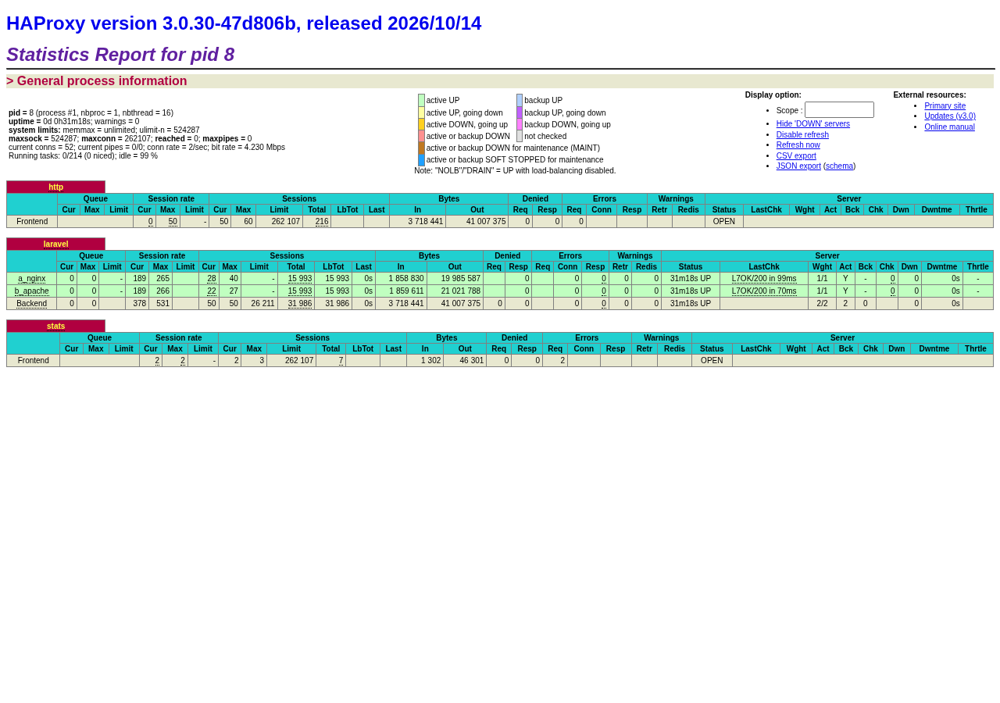

# Benchmark de Rendimiento: Arquitectura A vs Arquitectura B y HAProxy (SCRUM-33 / SCRUM-35)

Informe empírico comparativo de rendimiento entre la **Arquitectura A** (Nginx + PHP-FPM), la **Arquitectura B** (Apache + mod_php) y el balanceador de carga **HAProxy** para la plataforma web de agendamiento **Glow Dental Protect**.

---

## 1. Objetivo

Comparar de forma reproducible el comportamiento de dos arquitecturas monolíticas web y una capa de balanceo:
1. **Arquitectura A (Nginx 1.31 + PHP-FPM 8.4):** Modelo desacoplado donde Nginx actúa como servidor web asíncrono y delega la ejecución de scripts PHP al pool de procesos de PHP-FPM mediante el protocolo FastCGI.
2. **Arquitectura B (Apache 2.4 + mod_php 8.4):** Modelo acoplado tradicional donde el servidor HTTP Apache utiliza el módulo MPM Prefork y aloja el intérprete PHP directamente dentro de cada proceso hijo de Apache.
3. **HAProxy 3.0 (Roundrobin):** Balanceador de carga inverso que distribuye las solicitudes equitativamente (50% / 50%) entre la Arquitectura A (`web:80`) y la Arquitectura B (`apache:80`), proveyendo alta disponibilidad y tolerancia a fallos.

---

## 2. Entorno de pruebas

| Componente | Especificación / Versión |
|---|---|
| **CPU del host** | AMD Ryzen 7 7730U with Radeon Graphics (8 núcleos físicos, 16 hilos @ 2.0 GHz base / hasta 4.5 GHz boost) |
| **Memoria RAM** | 30 GiB DDR4 (18 GiB libres al momento de la prueba) |
| **Almacenamiento** | SSD NVMe PCIe 3.0 |
| **Sistema Operativo host** | Linux Fedora (Kernel 7.2.11 x86_64) |
| **Motor de contenedores** | Docker 27 / Docker Compose v2 |
| **Arquitectura A** | `nginx:alpine` (Nginx 1.31.3) + `php:8.4-fpm-alpine` (PHP 8.4.27) |
| **Arquitectura B** | `php:8.4-apache` (Apache 2.4.69 MPM Prefork + PHP 8.4.27 mod_php) |
| **Balanceador** | `haproxy:3.0-alpine` (HAProxy 3.0.30) |
| **Base de datos** | `postgres:16-alpine` (PostgreSQL 16.14) |
| **Caché y sesiones** | `redis:7-alpine` (Redis 7.4.11) |

> [!WARNING] Limitación de validez absoluta
> Tanto el generador de carga (`hey`), como los servidores web (Nginx, Apache, HAProxy), el backend (PHP-FPM) y los motores de persistencia (PostgreSQL y Redis) se ejecutan dentro del mismo host físico compartiendo CPU, memoria y bus de red local (interfaz de loopback / bridge Docker). Por ende, las métricas no deben interpretarse como máximos teóricos absolutos de producción, sino como una **comparación relativa** entre arquitecturas bajo las mismas condiciones. Además, el entorno es el de desarrollo: el código se monta como volumen y OPcache revisa marcas de tiempo (`validate_timestamps = 1`), lo que baja los números absolutos por igual en A y en B.

---

## 3. Paridad antes de medir (Garantía de condiciones equitativas)

Para que la comparación entre A y B sea válida, se revisaron y corrigieron los factores que podían sesgarla:

1. **Versión de PHP idéntica:**
   - Contenedor `app` (FPM): `PHP 8.4.27 (cli) NTS` con Zend OPcache v8.4.27.
   - Contenedor `apache`: `PHP 8.4.27 (cli) NTS` con Zend OPcache v8.4.27.
2. **Configuración de OPcache 100% idéntica:**
   Ambos contenedores cargan la misma configuración (`docker/php-fpm/php.ini`):
   - `opcache.enable = 1`
   - `opcache.enable_cli = 1`
   - `opcache.memory_consumption = 128` (128 MB)
   - `opcache.interned_strings_buffer = 8`
   - `opcache.max_accelerated_files = 10000`
   - `opcache.validate_timestamps = 1`
   - `opcache.revalidate_freq = 2`
3. **Paridad de procesos y concurrencia máxima (Ajuste clave):**
   - **Diferencia detectada:** Por omisión, la imagen Alpine de PHP-FPM define `pm.max_children = 5` en su pool dinámico, mientras que Apache en Debian con `mpm_prefork` viene configurado de serie con `MaxRequestWorkers 150`. Con concurrencia 50 y 100, PHP-FPM quedaba limitado por falta de procesos (5 contra 150) y la comparación no era justa.
   - **Corrección aplicada:** Se creó el archivo de configuración `docker/php-fpm/zz-docker.conf` incorporado al Dockerfile de PHP-FPM, estableciendo:
     - `pm = dynamic`
     - `pm.max_children = 150`
     - `pm.start_servers = 5`
     - `pm.min_spare_servers = 5`
     - `pm.max_spare_servers = 10`
     Esto iguala el máximo de trabajadores con el de Apache (`MaxRequestWorkers 150`, `StartServers 5`, `MinSpareServers 5`, `MaxSpareServers 10`) de Apache MPM Prefork.
4. **Mismos límites de recursos:**
   Ni en `docker-compose.yml` ni a nivel de cgroups se establecieron límites de CPU o memoria para ningún servicio; ambos pueden consumir libremente los recursos disponibles de la máquina.
5. **Mismo código y datos:**
   Ambos servicios montan el mismo código fuente de la aplicación vía bind-mount (`.:/var/www/html:z`) y comparten la misma base de datos PostgreSQL y la misma instancia de Redis.

---

## 4. Metodología de prueba

- **Herramienta generadora de carga:** `hey` (desarrollado en Go por JBD / Jaana Dogan), ejecutado desde el contenedor oficial `williamyeh/hey` con el flag `--network host` para eliminar capas adicionales de NAT y consultar directamente los puertos publicados en el host:
  - Arquitectura A: `http://localhost:8080`
  - Arquitectura B: `http://localhost:8081`
  - HAProxy: `http://localhost:8000`
- **Modo producción temporal:**
  Antes de iniciar la prueba, se ejecuta `php artisan optimize` (compilación y caché de configuración, eventos, rutas, vistas Blade e iconos) en ambos contenedores con `APP_DEBUG=false` y desactivación de rate limiting temporal (`RATE_LIMIT_API=0`), sin modificar el archivo `.env`. Un `trap` de bash ejecuta `php artisan optimize:clear` al terminar o si se cancela, y deja el entorno de desarrollo como estaba. Como A y B comparten el código, la caché se genera una sola vez.
- **Endpoints evaluados:**
  1. `/health`: Endpoint liviano de salud de Laravel que ejecuta una consulta SQL a PostgreSQL (`SELECT 1`) y un comando `PING` a Redis. Mide la sobrecarga base del framework y conectividad de red interna.
  2. `/`: Portada principal del sitio. Carga el layout Blade completo, consulta profesionales ordenados desde PostgreSQL con sus especialidades asociadas y compila el HTML en el servidor.
  3. `/api/v1/servicios`: Endpoint de la API REST que ejecuta consulta Eloquent con relaciones eager-loading (`with(['especialidad', 'profesionales'])`) y serializa los datos mediante API Resources a JSON.
- **Escenarios de carga:**
  - Concurrencias: **10**, **50** y **100** clientes concurrentes sostenidos.
  - Duración: **20 segundos** continuos por cada corrida.
  - Calentamiento previo: **5 segundos** de tráfico previo descartado antes de medir cada endpoint para precalentar OPcache, pools de conexión y buffers.
  - Repeticiones: **3 repeticiones independientes** para cada combinación (Arquitectura × Endpoint × Concurrencia).
  - Criterio de selección: se toma la **mediana** de las 3 repeticiones según los pedidos por segundo (RPS), para reducir el efecto de variaciones puntuales de la máquina.

---

## 5. Tabla de resultados comparativos (Mediana de 3 repeticiones)

A continuación se presentan los resultados consolidados obtenidos empíricamente en la máquina de pruebas:

| Arquitectura | Endpoint | Concurrencia | RPS (req/s) | Latencia p50 (ms) | Latencia p95 (ms) | Latencia p99 (ms) | Errores (%) |
|---|---|:---:|:---:|:---:|:---:|:---:|:---:|
| A (Nginx+FPM) | `/health` | 10 | 368.73 | 26.30 | 33.10 | 35.60 | 0.00% |
| A (Nginx+FPM) | `/health` | 50 | 392.03 | 121.40 | 213.90 | 260.30 | 0.00% |
| A (Nginx+FPM) | `/health` | 100 | 381.23 | 250.60 | 452.00 | 566.60 | 0.00% |
| A (Nginx+FPM) | `/` | 10 | 239.29 | 41.50 | 47.00 | 52.30 | 0.00% |
| A (Nginx+FPM) | `/` | 50 | 254.18 | 188.30 | 317.00 | 401.00 | 0.00% |
| A (Nginx+FPM) | `/` | 100 | 258.56 | 381.10 | 617.30 | 700.80 | 0.00% |
| A (Nginx+FPM) | `/api/v1/servicios` | 10 | 262.25 | 36.60 | 54.30 | 59.30 | 0.00% |
| A (Nginx+FPM) | `/api/v1/servicios` | 50 | 298.13 | 163.70 | 263.40 | 309.00 | 0.00% |
| A (Nginx+FPM) | `/api/v1/servicios` | 100 | 294.06 | 336.20 | 557.20 | 648.00 | 0.00% |
| B (Apache) | `/health` | 10 | 386.34 | 26.20 | 31.50 | 33.50 | 0.00% |
| B (Apache) | `/health` | 50 | 426.57 | 113.10 | 185.70 | 219.20 | 0.00% |
| B (Apache) | `/health` | 100 | 432.86 | 224.50 | 378.10 | 442.50 | 0.00% |
| B (Apache) | `/` | 10 | 245.07 | 39.50 | 55.70 | 62.70 | 0.00% |
| B (Apache) | `/` | 50 | 262.95 | 184.40 | 305.00 | 371.50 | 0.00% |
| B (Apache) | `/` | 100 | 265.08 | 368.70 | 620.00 | 727.60 | 0.00% |
| B (Apache) | `/api/v1/servicios` | 10 | 276.88 | 34.80 | 50.50 | 56.20 | 0.00% |
| B (Apache) | `/api/v1/servicios` | 50 | 300.22 | 160.00 | 271.10 | 337.50 | 0.00% |
| B (Apache) | `/api/v1/servicios` | 100 | 309.85 | 318.20 | 510.30 | 587.00 | 0.00% |
| HAProxy | `/health` | 10 | 398.19 | 24.90 | 29.40 | 31.40 | 0.00% |
| HAProxy | `/health` | 50 | 413.77 | 114.20 | 200.00 | 250.20 | 0.00% |
| HAProxy | `/health` | 100 | 411.76 | 231.30 | 357.40 | 440.80 | 0.00% |
| HAProxy | `/` | 10 | 232.87 | 42.70 | 48.10 | 51.60 | 0.00% |
| HAProxy | `/` | 50 | 253.78 | 186.00 | 306.10 | 366.00 | 0.00% |
| HAProxy | `/` | 100 | 249.97 | 387.50 | 603.00 | 706.00 | 0.00% |
| HAProxy | `/api/v1/servicios` | 10 | 253.17 | 37.20 | 56.80 | 62.10 | 0.00% |
| HAProxy | `/api/v1/servicios` | 50 | 272.69 | 172.40 | 302.90 | 407.60 | 0.00% |
| HAProxy | `/api/v1/servicios` | 100 | 289.74 | 326.80 | 503.40 | 622.60 | 0.00% |

---

## 6. Dashboard de HAProxy durante la prueba de carga

Durante la ejecución de las pruebas sostenidas contra el puerto `8000`, se capturó el estado del panel de estadísticas de HAProxy (`http://localhost:8404`):



En la captura se evidencia la distribución equitativa de las conexiones y el volumen de bytes transferidos hacia los dos servidores de backend (`a_nginx` en `web:80` y `b_apache` en `apache:80`) mediante el algoritmo `roundrobin`.

---

## 7. Interpretación

1. **El techo es compartido, no de cada arquitectura.** En los tres casos los RPS casi no suben de concurrencia 10 a 100 (por ejemplo `/health` en A: 369, 392 y 381), mientras la latencia crece en proporción. Eso indica que el sistema ya está saturado con 10 clientes. Como todo corre en la misma máquina (el generador de carga, A, B, HAProxy, PostgreSQL y Redis), compiten por la misma CPU.
2. **B rinde un poco más que A en pedidos cortos.** En `/health` con 100 clientes, B llega a 433 RPS contra 381 de A (+13 %). La explicación más probable es que mod_php ejecuta PHP dentro del mismo proceso de Apache, sin el salto por FastCGI que hace Nginx hacia PHP-FPM. Ese costo fijo pesa más cuanto más corto es el pedido.
3. **Con carga real de la aplicación la diferencia es chica.** En la portada (`/`) la diferencia es de 2 a 3 %, y en `/api/v1/servicios` de 1 a 5 %. La variación entre repeticiones de un mismo escenario es de un orden parecido, así que no se puede afirmar que una arquitectura sea mejor para la aplicación real: el tiempo lo domina el código PHP, la base y Redis, no el servidor web.
4. **HAProxy no suma capacidad en una sola máquina, y es lo esperable.** Con balanceo, los RPS quedan en el mismo rango que A o B solos, con una diferencia de latencia de alrededor de 1 ms en p50. Para que el balanceo aumente la capacidad, los nodos tienen que estar en máquinas distintas. Acá su aporte es la disponibilidad: si un nodo cae, el otro sigue atendiendo (ver `docs/demo-failover.md`).
5. **Sin errores.** Ningún escenario tuvo respuestas fuera de 2xx, también con 100 clientes simultáneos.

**Conclusión:** para esta aplicación, A y B son equivalentes en rendimiento dentro del margen de esta prueba. La elección entre ellas se puede hacer por otros criterios (consumo de memoria, operación, compatibilidad), y el valor de HAProxy en este despliegue es la tolerancia a fallos, no el rendimiento.

---

## 8. Cómo reproducir el benchmark

Para reproducir este benchmark en cualquier entorno con Docker y Docker Compose:

```bash
# 1. Levantar el stack completo (incluye apache y haproxy)
docker compose up -d

# 2. Ejecutar el benchmark automatizado
make bench
```

El script `scripts/benchmark.sh` se encarga automáticamente de verificar el estado de los servicios, optimizar Laravel en modo producción temporal, ejecutar las series de pruebas con `hey`, capturar las estadísticas de HAProxy, exportar los resultados a `docs/benchmark-resumen.csv` y limpiar el entorno al finalizar.
