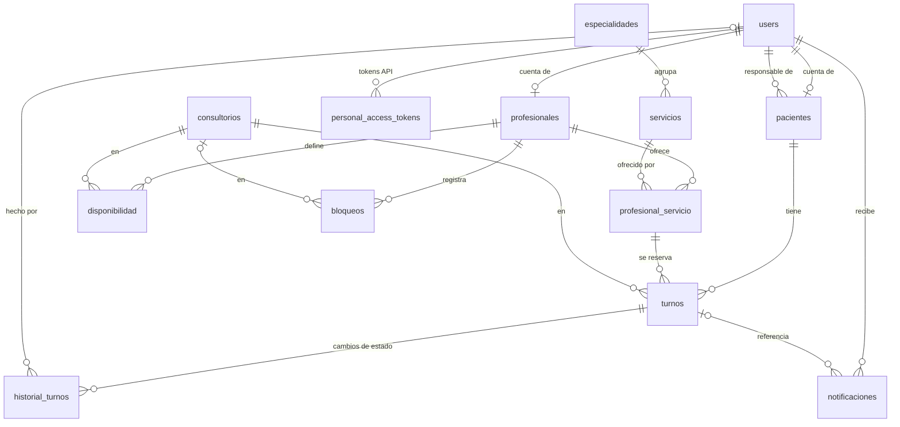

# Modelo de datos: MER, diccionario y normalización

Modelo relacional de la aplicación en PostgreSQL 16. Este documento se generó a partir del esquema real de la base (migraciones aplicadas al 24/10/2026) y reemplaza al diccionario preliminar de la Declaración de Alcance, que tenía cinco tablas.

**Convenciones:** nombres en español y en `snake_case`; claves primarias `id` autoincrementales (`BIGINT`), salvo en la tabla de relación N:M; claves foráneas `<tabla>_id` con `ON DELETE RESTRICT` (no se borra nada que tenga turnos o historial asociados); fechas de turnos y bloqueos en `TIMESTAMPTZ` (zona `America/Asuncion`); `created_at` y `updated_at` de Laravel en todas las tablas (se omiten en las tablas de abajo).

## 1. Diagrama entidad-relación

**Cardinalidades principales**

| Relación | Cardinalidad | Cómo se implementa |
|---|---|---|
| Cuenta – paciente | 1 : 0..1 | `pacientes.user_id` único y nulo |
| Cuenta responsable – familiares a cargo | 1 : N | `pacientes.responsable_id` |
| Cuenta – profesional | 1 : 1 | `profesionales.user_id` único y obligatorio |
| Especialidad – servicios | 1 : N | `servicios.especialidad_id` |
| Profesional – servicios | N : M | tabla `profesional_servicio` |
| Paciente – turnos | 1 : N | `turnos.paciente_id` |
| Profesional y servicio – turnos | 1 : N | FK compuesta `turnos(profesional_id, servicio_id)` → `profesional_servicio` |
| Turno – historial | 1 : N | `historial_turnos.turno_id` |
| Turno – notificaciones | 1 : N | `notificaciones.turno_id` |

## 2. Diccionario de datos

Columna **Clave**: PK = clave primaria, FK = clave foránea, UQ = valor único.

### `users`

Cuentas de acceso. El rol define qué ve cada usuario.

| Campo | Tipo | Nulo | Clave | Por defecto | Descripción |
|---|---|:---:|---|---|---|
| `id` | BIGINT | no | PK | autoincremental | Identificador |
| `email` | VARCHAR(255) | no | UQ |  | Correo de inicio de sesión |
| `email_verified_at` | TIMESTAMP | sí |  |  | Fecha de verificación del correo (no se usa todavía) |
| `password` | VARCHAR(255) | no |  |  | Hash bcrypt de la contraseña |
| `rol` | VARCHAR(20) | no |  |  | `paciente`, `profesional` o `funcionario` |
| `remember_token` | VARCHAR(100) | sí |  |  | Token de "recordarme" |
| `privacidad_aceptada_at` | TIMESTAMP | sí |  |  | Fecha en que aceptó la política de privacidad al registrarse |

### `pacientes`

Personas que se atienden. Pueden no tener cuenta propia (menores, pacientes cargados por recepción).

| Campo | Tipo | Nulo | Clave | Por defecto | Descripción |
|---|---|:---:|---|---|---|
| `id` | BIGINT | no | PK | autoincremental | Identificador |
| `user_id` | BIGINT | sí | FK → `users.id`, UQ |  | Cuenta propia del paciente, si tiene |
| `responsable_id` | BIGINT | sí | FK → `users.id` |  | Cuenta del adulto a cargo (familiar), si corresponde |
| `nombre` | VARCHAR(100) | no |  |  | Nombre |
| `apellido` | VARCHAR(100) | no |  |  | Apellido |
| `tipo_documento` | VARCHAR(20) | no |  |  | `CI` o `pasaporte` |
| `documento` | VARCHAR(30) | no |  |  | Número de documento |
| `telefono` | VARCHAR(30) | sí |  |  | Celular normalizado `09XXXXXXXX` |
| `fecha_nacimiento` | DATE | no |  |  | Fecha de nacimiento (no futura) |

### `profesionales`

Profesionales que atienden. Cada una tiene su cuenta.

| Campo | Tipo | Nulo | Clave | Por defecto | Descripción |
|---|---|:---:|---|---|---|
| `id` | BIGINT | no | PK | autoincremental | Identificador |
| `user_id` | BIGINT | no | FK → `users.id`, UQ |  | Cuenta de acceso |
| `nombre` | VARCHAR(100) | no |  |  | Nombre |
| `apellido` | VARCHAR(100) | no |  |  | Apellido |
| `matricula` | VARCHAR(30) | no | UQ |  | Matrícula profesional |
| `orden` | SMALLINT | no |  | '100' | Posición en las listas (menor primero) |
| `activo` | BOOLEAN | no | índice | true | Habilita acceso y nuevas reservas; la baja conserva el historial, servicios y horarios |

### `especialidades`

Áreas de la odontología que agrupan servicios.

| Campo | Tipo | Nulo | Clave | Por defecto | Descripción |
|---|---|:---:|---|---|---|
| `id` | BIGINT | no | PK | autoincremental | Identificador |
| `nombre` | VARCHAR(100) | no | UQ |  | Nombre de la especialidad |
| `activa` | BOOLEAN | no |  | true | Si se muestra y se puede usar |

### `servicios`

Tratamientos que se pueden reservar.

| Campo | Tipo | Nulo | Clave | Por defecto | Descripción |
|---|---|:---:|---|---|---|
| `id` | BIGINT | no | PK | autoincremental | Identificador |
| `especialidad_id` | BIGINT | no | FK → `especialidades.id` |  | Especialidad a la que pertenece |
| `nombre` | VARCHAR(100) | no |  |  | Nombre del servicio |
| `duracion_min` | SMALLINT | no |  |  | Duración por defecto, en minutos (> 0) |
| `precio` | INTEGER | sí |  |  | Precio en guaraníes (entero, ≥ 0); nulo = a consultar |
| `activo` | BOOLEAN | no |  | true | Si se ofrece |
| `descripcion` | TEXT | sí |  |  | Texto para el catálogo |

### `profesional_servicio`

Qué servicios realiza cada profesional (relación N:M).

| Campo | Tipo | Nulo | Clave | Por defecto | Descripción |
|---|---|:---:|---|---|---|
| `profesional_id` | BIGINT | no | PK, FK → `profesionales.id` |  | Profesional |
| `servicio_id` | BIGINT | no | PK, FK → `servicios.id` |  | Servicio |

### `consultorios`

Lugares de atención. Hoy hay uno; el modelo admite más.

| Campo | Tipo | Nulo | Clave | Por defecto | Descripción |
|---|---|:---:|---|---|---|
| `id` | BIGINT | no | PK | autoincremental | Identificador |
| `nombre` | VARCHAR(100) | no |  |  | Nombre |
| `direccion` | VARCHAR(255) | sí |  |  | Dirección |
| `telefono` | VARCHAR(30) | sí |  |  | Teléfono |
| `activo` | BOOLEAN | no |  | true | Si está en uso |

### `disponibilidad`

Horario semanal de cada profesional.

| Campo | Tipo | Nulo | Clave | Por defecto | Descripción |
|---|---|:---:|---|---|---|
| `id` | BIGINT | no | PK | autoincremental | Identificador |
| `profesional_id` | BIGINT | no | FK → `profesionales.id` |  | Profesional |
| `consultorio_id` | BIGINT | no | FK → `consultorios.id` |  | Dónde atiende en esa franja |
| `dia_semana` | SMALLINT | no |  |  | 1 = lunes … 7 = domingo (ISO) |
| `hora_inicio` | TIME | no |  |  | Inicio de la franja |
| `hora_fin` | TIME | no |  |  | Fin de la franja (> inicio) |

### `bloqueos`

Ausencias puntuales (vacaciones, congresos).

| Campo | Tipo | Nulo | Clave | Por defecto | Descripción |
|---|---|:---:|---|---|---|
| `id` | BIGINT | no | PK | autoincremental | Identificador |
| `profesional_id` | BIGINT | no | FK → `profesionales.id` |  | Profesional |
| `consultorio_id` | BIGINT | sí | FK → `consultorios.id` |  | Consultorio afectado; nulo = no atiende en ninguno |
| `inicio` | TIMESTAMPTZ | no |  |  | Desde |
| `fin` | TIMESTAMPTZ | no |  |  | Hasta (> inicio) |
| `motivo` | VARCHAR(255) | sí |  |  | Motivo opcional |

### `turnos`

Reserva de un paciente con una profesional para un servicio.

| Campo | Tipo | Nulo | Clave | Por defecto | Descripción |
|---|---|:---:|---|---|---|
| `id` | BIGINT | no | PK | autoincremental | Identificador |
| `paciente_id` | BIGINT | no | FK → `pacientes.id` |  | Paciente que se atiende |
| `profesional_id` | BIGINT | no | FK → `profesionales.id` |  | Profesional que atiende |
| `servicio_id` | BIGINT | no | FK → `servicios.id` |  | Servicio reservado |
| `consultorio_id` | BIGINT | no | FK → `consultorios.id` |  | Consultorio asignado |
| `inicio` | TIMESTAMPTZ | no |  |  | Fecha y hora de inicio |
| `fin` | TIMESTAMPTZ | no |  |  | Fecha y hora de fin (> inicio) |
| `estado` | VARCHAR(20) | no |  |  | `solicitado`, `confirmado`, `atendido`, `cancelado` o `ausente` |
| `observaciones` | TEXT | sí |  |  | Notas internas |
| `motivo_cancelacion` | VARCHAR(255) | sí |  |  | Motivo, si se canceló |

### `historial_turnos`

Registro de cada cambio de estado de un turno (auditoría).

| Campo | Tipo | Nulo | Clave | Por defecto | Descripción |
|---|---|:---:|---|---|---|
| `id` | BIGINT | no | PK | autoincremental | Identificador |
| `turno_id` | BIGINT | no | FK → `turnos.id` |  | Turno |
| `estado_anterior` | VARCHAR(20) | sí |  |  | Estado previo (nulo al crearse) |
| `estado_nuevo` | VARCHAR(20) | no |  |  | Estado resultante |
| `usuario_id` | BIGINT | sí | FK → `users.id` |  | Quién hizo el cambio; nulo = automático |
| `detalle` | VARCHAR(255) | sí |  |  | Detalle opcional (por ejemplo, la reprogramación) |

### `notificaciones`

Avisos enviados por turno, para no duplicarlos y saber si fallaron.

| Campo | Tipo | Nulo | Clave | Por defecto | Descripción |
|---|---|:---:|---|---|---|
| `id` | BIGINT | no | PK | autoincremental | Identificador |
| `destinatario_id` | BIGINT | no | FK → `users.id` |  | Cuenta que recibe el aviso |
| `turno_id` | BIGINT | sí | FK → `turnos.id` |  | Turno al que se refiere |
| `tipo` | VARCHAR(20) | no |  |  | `confirmacion`, `recordatorio`, `cancelacion` o `reprogramacion` |
| `canal` | VARCHAR(20) | no |  | 'correo' | Canal principal (`correo`); WhatsApp se envía en el mismo aviso |
| `estado` | VARCHAR(20) | no |  | 'pendiente' | `pendiente`, `enviada` o `fallida` |
| `enviado_at` | TIMESTAMPTZ | sí |  |  | Fecha de envío |

### `personal_access_tokens`

Tokens de la API REST (Laravel Sanctum).

| Campo | Tipo | Nulo | Clave | Por defecto | Descripción |
|---|---|:---:|---|---|---|
| `id` | BIGINT | no | PK | autoincremental | Identificador |
| `tokenable_type` | VARCHAR(255) | no |  |  | Clase del dueño (`App\Models\User`) |
| `tokenable_id` | BIGINT | no |  |  | Id del usuario |
| `name` | TEXT | no |  |  | Nombre del dispositivo |
| `token` | VARCHAR(64) | no | UQ |  | Hash SHA-256 del token |
| `abilities` | TEXT | sí |  |  | Permisos del token |
| `last_used_at` | TIMESTAMP | sí |  |  | Último uso |
| `expires_at` | TIMESTAMP | sí |  |  | Vencimiento (nulo = no vence) |

## 3. Restricciones de integridad

| Tabla | Restricción | Para qué |
|---|---|---|
| `users` | `CHECK rol IN ('paciente','profesional','funcionario')` | Solo roles válidos |
| `pacientes` | `UNIQUE (tipo_documento, documento)` | Una persona no se carga dos veces |
| `pacientes` | `CHECK tipo_documento IN ('CI','pasaporte')`, `CHECK fecha_nacimiento <= CURRENT_DATE` | Datos válidos |
| `servicios` | `CHECK duracion_min > 0`, `CHECK precio IS NULL OR precio >= 0` | Datos válidos |
| `disponibilidad` | `CHECK dia_semana BETWEEN 1 AND 7`, `CHECK hora_fin > hora_inicio` | Franjas coherentes |
| `bloqueos`, `turnos` | `CHECK fin > inicio` | Rangos coherentes |
| `turnos` | `CHECK estado IN (...)` y lo mismo en `historial_turnos` | Solo estados válidos |
| `turnos` | `EXCLUDE USING gist (profesional_id WITH =, tstzrange(inicio, fin, '[)') WITH &&) WHERE estado <> 'cancelado'` | **Una profesional no puede tener dos turnos superpuestos**, aunque dos personas reserven a la vez. Los cancelados liberan el horario. Requiere la extensión `btree_gist` |
| `turnos` | `EXCLUDE USING gist (paciente_id WITH =, tstzrange(inicio, fin, '[)') WITH &&) WHERE estado <> 'cancelado'` | **Un paciente no puede tener dos turnos superpuestos**, aunque sean con profesionales distintas. Los cancelados no cuentan. Restricción `turnos_paciente_sin_solapamiento` |
| `turnos` | FK compuesta `(profesional_id, servicio_id)` → `profesional_servicio` | Solo se reserva un servicio que esa profesional realiza |
| `notificaciones` | `CHECK tipo IN (...)`, `CHECK estado IN (...)` | Valores válidos |
| `notificaciones` | `UNIQUE (turno_id, tipo, destinatario_id) WHERE turno_id IS NOT NULL` | El mismo aviso no se manda dos veces |

## 4. Índices

| Tabla | Índice | Consulta que acelera |
|---|---|---|
| `turnos` | `(profesional_id, inicio)` | Agenda del día y de la semana de cada profesional; horarios libres |
| `turnos` | `(paciente_id, inicio)` | "Mis turnos" y ficha del paciente |
| `turnos` | GiST `(profesional_id, tstzrange(inicio, fin))` parcial | Lo crea la restricción de exclusión; también acelera la búsqueda de superposiciones |
| `notificaciones` | `(estado)` | Cola de avisos pendientes |
| `personal_access_tokens` | `(token)` único, `(tokenable_type, tokenable_id)`, `(expires_at)` | Autenticación de la API |
| Varias | Índices únicos de `email`, `matricula`, `nombre` de especialidad, documento | Unicidad y búsqueda directa |

## 5. Normalización (3FN)

**Primera forma normal.** Todos los atributos son atómicos: no hay listas ni campos repetidos. Los servicios de cada profesional no se guardan como lista en `profesionales`, sino en la tabla `profesional_servicio`, una fila por par. El horario semanal es una fila por franja en `disponibilidad`, no columnas "lunes", "martes", etc.

**Segunda forma normal.** Las tablas con clave simple (`id`) cumplen 2FN automáticamente. La única con clave compuesta, `profesional_servicio (profesional_id, servicio_id)`, no tiene atributos propios además de las fechas de Laravel, así que no hay dependencias parciales.

**Tercera forma normal.** Ningún atributo no clave depende de otro atributo no clave:
- Los datos de la especialidad no se repiten en `servicios`: solo está `especialidad_id`.
- Las especialidades de una profesional no se guardan: se deducen de los servicios que realiza.
- Los turnos guardan solo las claves de paciente, profesional, servicio y consultorio; nombres, precios y duraciones se leen de sus tablas.
- Nombre y documento viven en `pacientes` y `profesionales`, no en `users`; `users` solo guarda lo necesario para entrar al sistema. Así, un paciente sin cuenta (un menor) existe sin una fila en `users`.
- El correo se guarda una sola vez, en `users`. El de un familiar sin cuenta se obtiene a través de su responsable.

**Decisiones que parecen redundancia pero son intencionales:**
- **`turnos.fin`** podría calcularse como `inicio + servicios.duracion_min`, pero la duración del servicio puede cambiar después de reservado el turno, y un turno puntual puede ajustarse. Guardar `fin` registra el hecho tal como se acordó. Además, la restricción de exclusión necesita el rango `[inicio, fin)` en la propia fila para impedir superposiciones dentro de la base.
- **`turnos.consultorio_id`** registra dónde se acordó la atención en ese momento. Si después cambia el horario semanal en `disponibilidad`, el turno ya reservado no se mueve.
- **`historial_turnos.estado_anterior`** podría deducirse de la fila anterior del historial, pero es una tabla de auditoría: cada fila se lee sola y no se modifica nunca.

## 6. Tablas de infraestructura de Laravel

No forman parte del dominio. `migrations` registra las versiones del esquema, `password_reset_tokens` la recuperación de contraseña y `failed_jobs` los avisos que fallaron en todos sus reintentos. `sessions`, `cache`, `cache_locks`, `jobs` y `job_batches` las crea Laravel pero quedan vacías: sesiones, caché y cola de avisos viven en Redis, para que las arquitecturas A y B las compartan.
