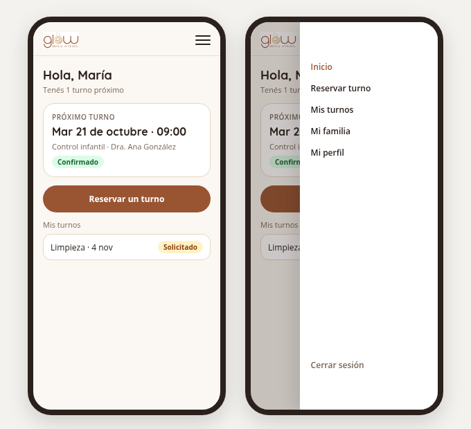
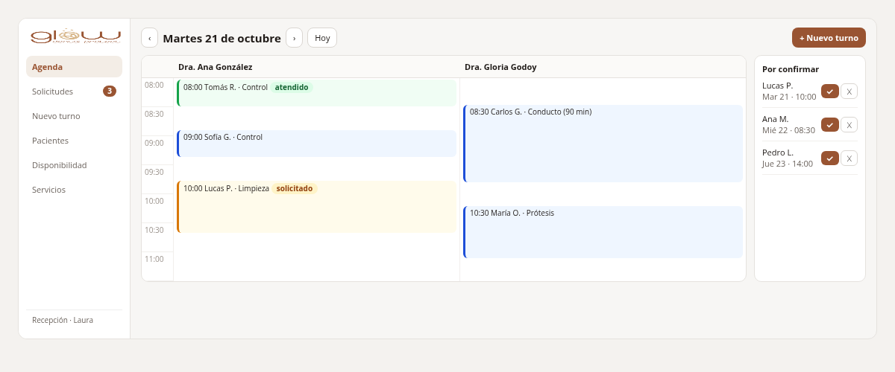
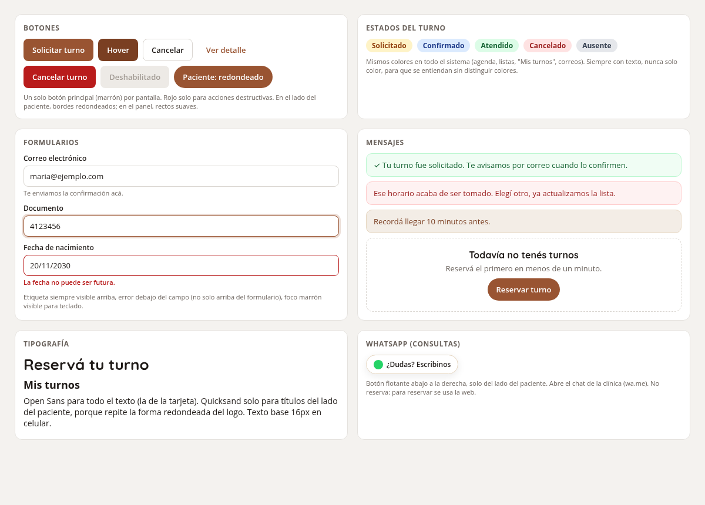

# Guía para hacer pantallas

Cómo construir una vista nueva siguiendo el diseño del proyecto. El **qué** (colores, layouts, reglas) está en [`diseno-ui.md`](diseno-ui.md); acá está el **cómo**.

## 1. Antes de empezar

```bash
git pull
docker compose up -d        # levanta todo, incluido el contenedor node
```

- Los estilos se recompilan solos al guardar (contenedor `node`). Si ves `Vite manifest not found`, esperá la primera compilación: `docker compose logs -f node`.
- **Catálogo de componentes en vivo:** http://localhost:8080/ui (solo en local). Mirá ahí cómo se ve cada componente antes de usarlo.

## 2. Cómo se ve

**Paciente** (celular, estilo cálido): menú hamburguesa, próximo turno y botón para reservar.



**Panel de la profesional y recepción** (PC, estilo clínico): barra lateral, agenda por doctora y solicitudes por confirmar.



**Componentes base:**



Lo que ya está implementado: el catálogo [`/ui`](img/ui-catalogo.png) y el [registro en el celular](img/registro-celular.png).

## 3. Una pantalla nueva, paso a paso

Ejemplo: "Mis turnos" del paciente.

**1. Ruta con nombre** (`routes/web.php`). El nombre importa: el menú lo usa.

```php
Route::middleware('auth')->group(function () {
    Route::get('/mis-turnos', [MisTurnosController::class, 'index'])->name('paciente.turnos');
});
```

**2. Vista** (`resources/views/paciente/turnos.blade.php`): siempre dentro de un layout, armada con componentes.

```blade
<x-layouts.paciente titulo="Mis turnos">
    <h1 class="font-display text-2xl font-bold text-ink-900">Mis turnos</h1>

    @forelse ($turnos as $turno)
        <x-card :paciente="true" class="mt-4">
            <div class="flex items-center justify-between gap-3">
                <div>
                    <p class="font-semibold">{{ $turno->servicio->nombre }}</p>
                    <p class="text-sm text-ink-500">{{ $turno->inicio->translatedFormat('l j \d\e F, H:i') }}</p>
                </div>
                <x-estado-turno :estado="$turno->estado" />
            </div>
        </x-card>
    @empty
        <x-empty-state titulo="Todavía no tenés turnos" texto="Reservá el primero en menos de un minuto." class="mt-4">
            <x-button :href="route('paciente.reservar')" :pill="true">Reservar turno</x-button>
        </x-empty-state>
    @endforelse
</x-layouts.paciente>
```

**3. Menú.** Si la pantalla va en el menú, la ruta ya tiene que estar en `app/Support/Navegacion.php` (ahí están todas las previstas). El ítem aparece solo cuando la ruta existe; no hay que tocar el layout.

**4. Mensajes.** Después de guardar, redirigí con un flash; el layout lo muestra solo:

```php
return redirect()->route('paciente.turnos')->with('success', 'Tu turno fue solicitado.');
```

**5. Test** de la pantalla (`tests/Feature/...`): que responda 200, que muestre lo esperado y que otro rol no pueda entrar.

## 4. Qué componente uso

| Necesito… | Uso |
|---|---|
| Página del paciente / del panel / pública | `<x-layouts.paciente titulo="…">`, `<x-layouts.panel titulo="…">`, `<x-layouts.invitado titulo="…">` |
| Botón o link con forma de botón | `<x-button>` · `variant="primary\|secondary\|ghost\|danger"` · `:pill="true"` del lado del paciente · `href="…"` para link · `type="submit"` en formularios |
| Campo de texto, correo, contraseña | `<x-input name="email" label="Correo electrónico" type="email" help="…" />` (muestra el error y `old()` solo) |
| Lista desplegable | `<x-select name="tipo_documento" label="Tipo de documento" :options="['CI' => 'Cédula', 'pasaporte' => 'Pasaporte']" />` |
| Fecha | `<x-date name="fecha_nacimiento" label="Fecha de nacimiento" :max="now()->toDateString()" />` |
| Estado de un turno | `<x-estado-turno :estado="$turno->estado" />` |
| Mensaje en la página | `<x-alert type="success\|error\|info">…</x-alert>` |
| Caja / tarjeta | `<x-card>` (panel) · `<x-card :paciente="true">` (paciente) |
| Lista vacía | `<x-empty-state titulo="…" texto="…">` + botón en el slot |
| Elegir horario | `<x-slot-picker name="hora" :horarios="[['hora' => '09:00', 'libre' => true], …]" />` |
| Confirmar algo destructivo | `<x-modal name="cancelar-turno" titulo="¿Cancelar el turno?">…</x-modal>` y para abrirlo: `x-on:click="$dispatch('abrir-modal', 'cancelar-turno')"` |

Si un componente no alcanza, se mejora el componente (con su test en `tests/Feature/ComponentesTest.php`), no se copia el estilo en la vista.

## 5. Reglas

**Sí:**
- Colores solo con los nombres del tema: `bg-brand-600`, `text-ink-500`, `border-line`, `bg-cream-50`, `bg-surface`… (lista completa en `resources/css/app.css` y en la sección 3.2 de `diseno-ui.md`).
- Títulos del lado del paciente con `font-display` (Quicksand); el resto con la fuente por defecto (Open Sans).
- Un solo botón principal por pantalla.
- Textos en español: "Reservá", "Elegí", "Tu turno fue solicitado".
- Probar en el celular (390 px) y en la PC (1280 px). En Chrome: F12 → ícono de dispositivo.

**No:**
- ❌ Colores sueltos: `bg-[#995432]`, `style="color: …"`, `text-amber-700`.
- ❌ `text-brand-300` (el Burlywood no se lee sobre blanco).
- ❌ Tailwind por CDN (`cdn.tailwindcss.com`) ni librerías de UI externas.
- ❌ Clases armadas con variables: `"bg-{$color}-100"`. Tailwind no las detecta y no se generan. Usá un arreglo con las clases completas (ver `estado-turno.blade.php`).
- ❌ HTML de formulario a mano cuando existe `<x-input>`, `<x-select>` o `<x-date>`.
- ❌ Íconos con emojis: usá SVG con `aria-hidden="true"`.

## 6. Antes de abrir el PR

- [ ] La vista usa un layout y los componentes; no hay colores sueltos.
- [ ] Se ve bien a 390 px y a 1280 px, sin scroll horizontal.
- [ ] Se puede usar con teclado (Tab muestra el foco marrón) y los campos tienen etiqueta.
- [ ] `docker compose exec -T -u 1000 app php artisan test` en verde.
- [ ] `docker compose exec -T -u 1000 app ./vendor/bin/pint` sin cambios pendientes.
- [ ] Rama `feat/SCRUM-<n>-…` y título del PR `feat(SCRUM-<n>): …`.
